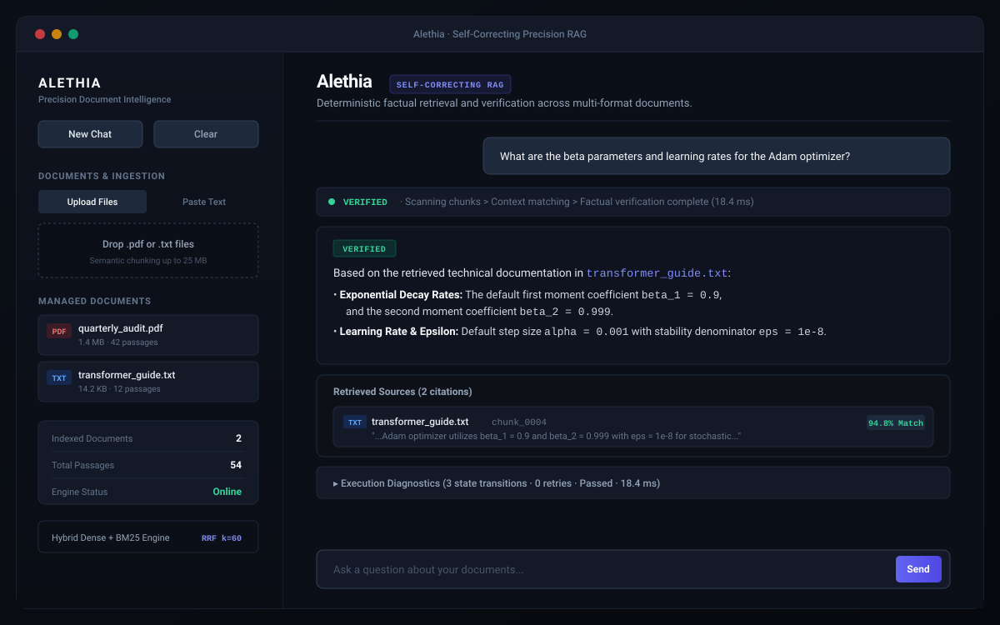

# Alethia

[](https://share.streamlit.io)
[](https://www.python.org/)
[](https://github.com/langchain-ai/langgraph)
[](https://www.trychroma.com/)
[](LICENSE)

A minimal, deterministic, and self-correcting Retrieval-Augmented Generation (RAG) engine designed for verified document intelligence.

Alethia combines dense semantic embeddings, Okapi BM25 lexical search, reciprocal rank fusion, automated document-reference targeting, and a cyclic LangGraph verification loop to produce accurate, hallucination-free responses backed by verifiable source citations.

---

## Live Demo & Interface

Experience the deployed application on Streamlit Community Cloud:  
**[Launch Alethia Web Application](https://share.streamlit.io)**



---

## Core Architecture

```
User Query
    │
    ├── 1. Document Target Detection
    │      Identifies if a specific document is referenced (e.g., "report.pdf")
    │      and scopes retrieval to eliminate cross-file noise.
    │
    ├── 2. Hybrid Retrieval (Dense + BM25)
    │      Combines ChromaDB vector search (cosine similarity) with
    │      sparse lexical rankings via Reciprocal Rank Fusion (RRF, k=60).
    │
    ├── 3. Question Decomposition
    │      Decomposes multi-intent questions into standalone sub-queries
    │      with independent context gathering.
    │
    └── 4. Cyclic Verification StateGraph
           ├── Synthesis: Generates draft strictly grounded in retrieved passages.
           ├── Evaluation: LLM Judge validates factual grounding against context.
           ├── Decision: PASS proceeds to response; FAIL triggers targeted rewrite.
           └── Self-Correction: Re-retrieves novel passages (up to 2 attempts).
```

---

## Key Capabilities

- **Self-Correcting Verification Loop**: Cyclic LangGraph workflow with an LLM Judge that verifies factual alignment before returning answers, automatically rewriting queries if evidence is missing.
- **Targeted Document Isolation**: Automatically detects document references in queries and scopes search directly to that file, avoiding irrelevant matches from other documents.
- **Hybrid Retrieval (Dense + BM25)**: Evaluates semantic similarity alongside lexical precision using Reciprocal Rank Fusion (RRF).
- **Multi-Format Ingestion**: Ingests `.pdf` documents, `.txt` files, and direct text notes with sentence-aware chunking and duplicate detection.
- **Progressive Execution Status**: Real-time multi-step progress indicators detailing scanning, passage selection, and verification.
- **Auditable Diagnostics**: Expandable diagnostics showing latency, state transitions, retrieval strategies, and citation match percentages.

---

## Quickstart

### Prerequisites

- Python 3.10 or higher
- A [Groq Cloud](https://console.groq.com/) API account

### Local Setup

1. **Clone the repository:**
   ```bash
   git clone https://github.com/samikshahujare/Alethia.git
   cd Alethia
   ```

2. **Create and activate a virtual environment:**
   ```bash
   # Windows
   python -m venv .venv
   .venv\Scripts\activate

   # macOS / Linux
   python3 -m venv .venv
   source .venv/bin/activate
   ```

3. **Install dependencies:**
   ```bash
   pip install -r requirements.txt
   ```

4. **Configure environment:**
   ```bash
   cp .env.example .env
   ```
   Add your credentials to `.env` following `.env.example`.

5. **Start the application:**
   ```bash
   streamlit run app.py
   ```
   The application will be accessible at `http://localhost:8501`.

---

## Deployment

### Streamlit Community Cloud

1. Push your repository to GitHub.
2. Visit [share.streamlit.io](https://share.streamlit.io) and link your GitHub repository.
3. Set the main file path to `app.py`.
4. Under **Advanced Settings > Secrets**, configure your environment variables:
   ```toml
   GROQ_API_KEY = "your-api-key"
   GROQ_MODEL = "openai/gpt-oss-20b"
   ```
5. Click **Deploy**.

### Docker Deployment

```bash
docker build -t alethia .
docker run -p 8501:8501 --env-file .env alethia
```

---

## Project Structure

```
Alethia/
├── app.py                     # Streamlit application entrypoint
├── src/
│   ├── config.py              # Environment configuration & validation
│   ├── document_loader.py     # PDF, TXT, and text note ingestion
│   ├── text_cleaner.py        # Unicode & whitespace normalization
│   ├── chunker.py             # Boundary-aware semantic chunking
│   ├── store.py               # ChromaDB persistence & vector retrieval
│   ├── bm25.py                # Okapi BM25 index & lexical search
│   ├── hybrid_retriever.py    # Reciprocal Rank Fusion (RRF)
│   ├── document_inspection.py # Targeted document extraction & resolution
│   ├── decomposition.py       # Multi-intent query decomposition
│   ├── prompts.py             # Strict system prompts & formatting
│   ├── state.py               # LangGraph StateGraph schemas
│   ├── nodes.py               # Workflow graph execution nodes
│   ├── graph.py               # StateGraph compilation & pipeline runner
│   └── llm.py                 # Groq client wrapper with retry logic
├── ui/
│   ├── styles.py              # Dark-first minimalist stylesheet
│   ├── sidebar.py             # File ingestion, document manager & specs
│   ├── chat.py                # Progressive status & chat lifecycle
│   ├── sources.py             # Citation cards with similarity scoring
│   └── trace.py               # Execution diagnostics timeline
├── docs/                      # Technical reports & UI assets
└── tests/                     # Test suite
```

---

## Verification & Testing

Alethia maintains a test suite covering document parsing, hybrid retrieval, document targeting, and UI rendering:

```bash
pytest tests/
```

To run a specific test group:
```bash
pytest tests/test_document_loader_pdf.py
pytest tests/test_document_targeting.py
pytest tests/test_hybrid_retriever.py
```

---

## License

This project is licensed under the [MIT License](LICENSE).
