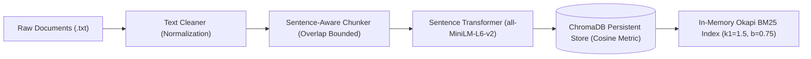
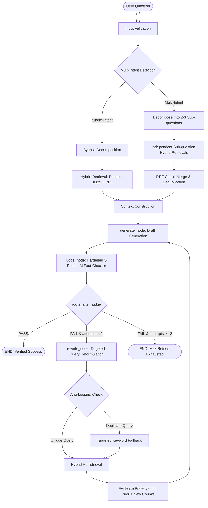
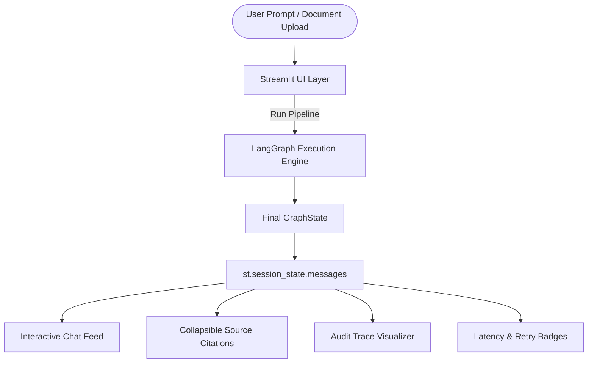

# Alethia: Self-Correcting Hybrid RAG Engine

[](https://www.python.org/downloads/)
[](https://github.com/langchain-ai/langgraph)
[-purple.svg)](https://groq.com/)
[](https://www.trychroma.com/)
[-yellow.svg)](https://sbert.net/)
[](file:///src/hybrid_retriever.py)
[](https://streamlit.io/)
[](file:///tests)
[](file:///docs/PHASE5_RETRIEVAL_BENCHMARK.md)

Alethia is a self-correcting hybrid Retrieval-Augmented Generation (RAG) engine designed to deliver accurate, hallucination-free, and verifiable question answering over custom knowledge bases. Built as an agentic cyclic state machine powered by **LangGraph**, **ChromaDB**, **Sentence Transformers**, a **Pure-Python Okapi BM25 engine**, **Reciprocal Rank Fusion (RRF)**, **Intelligent Question Decomposition**, and a **Hardened 5-Rule LLM-as-a-Judge** on **Groq (`openai/gpt-oss-20b`)**, Alethia autonomously assesses retrieved context, validates generated answers, reformulates vague queries, and enforces strict bounded retries.

---

## 1. Problem Statement & Motivation

Traditional RAG architectures follow an open-loop pipeline: `Query → Vector Search → LLM Generation → Answer`. This static pattern suffers from four fundamental failure modes:

1. **Dense Retrieval Blind Spots**: Pure dense vector similarity often retrieves semantically adjacent but factually unhelpful text chunks, missing exact keyword identifiers, numbers, or technical formulas.
2. **Multi-Part Query Conflation**: Multi-intent questions (e.g., *"What optimizer was used in the Transformer, and what are Adam's default beta values?"*) pull retrieval toward the dominant topic, starving other sub-questions of evidence.
3. **Hallucination & Misalignment**: When context is incomplete, LLMs frequently invent plausible-sounding details rather than cleanly abstaining.
4. **Lack of Feedback & Self-Correction**: Open-loop systems lack an auditing mechanism to evaluate whether claims are factually grounded and cannot iteratively refine their queries when retrieval fails.

### The Alethia Solution

Alethia transforms RAG into a **closed-loop agentic state machine**:
- **Hybrid Retrieval (Dense + BM25 + RRF)**: Fuses 384-dimensional dense semantic rankings (`all-MiniLM-L6-v2`) and sparse lexical rankings (Pure-Python Okapi BM25, $k_1=1.5, b=0.75$) using Reciprocal Rank Fusion ($k=60$).
- **Intelligent Question Decomposition**: Single-intent queries bypass decomposition with zero latency, while multi-intent queries decompose into 2–3 independent sub-questions that retrieve evidence independently.
- **Grounded Answer Generation**: Synthesizes concise answers strictly confined to retrieved facts at temperature 0.1.
- **Hardened 5-Rule LLM-as-a-Judge**: Evaluates the complete composite question against retrieved evidence under a hardened 5-scenario rubric.
- **Targeted Query Rewriting & Anti-Looping**: Isolates missing or unsupported requirements from Judge feedback, prevents query repetition via normalized history matching, and falls back to deterministic keyword reformulation when loops occur.
- **Evidence Preservation**: Earlier retrieved chunks are retained across retry iterations while newly discovered chunks are tracked explicitly.
- **Strict Bounded Determinism**: Hard-coded maximum of 2 rewrites (3 generation cycles max) bounds execution latency and guarantees predictable token consumption.
- **Verified Abstention**: When context genuinely lacks the answer, the engine outputs `"Not in context."` and passes judgment without wasteful retries (Rule 2).

---

## 2. System Architecture & Workflows

### 2.1. Ingestion & Storage Architecture



1. **Loader (`src/document_loader.py`)**: Ingests UTF-8 documents with deduplication and metadata extraction.
2. **Cleaner (`src/text_cleaner.py`)**: Normalizes whitespace, strips control characters, and standardizes punctuation while preserving sentence delimiters.
3. **Chunker (`src/chunker.py`)**: Partitions text along paragraph and sentence boundaries (target size: 300–800 chars, overlap: 50–100 chars), preventing mid-sentence truncation.
4. **Vector Store (`src/store.py`)**: Persists embeddings in local ChromaDB using cosine similarity.
5. **BM25 Ingestion (`src/bm25.py`)**: Authoritative synchronization from ChromaDB into the in-memory inverted index.

---

### 2.2. LangGraph Cyclic Self-Correction State Machine



#### Node Roles & Transition Contract:
- **`START → retrieve_node`**: Executes hybrid retrieval for the active query. On attempt 0, multi-intent queries decompose into sub-questions, retrieving evidence independently and merging chunks via RRF.
- **`retrieve_node → generate_node`**: Assembles retrieved chunk text into an unpolluted context block. If no chunks exist, immediately drafts `"Not in context."` without invoking LLM inference.
- **`generate_node → judge_node`**: Acts as an impartial LLM fact-checker. Strictly evaluates whether every claim in the draft is directly corroborated by the retrieved context.
- **`judge_node → route_after_judge`**:
  - `verdict == "PASS"` $\rightarrow$ `END`.
  - `verdict == "FAIL"` and `attempts < 2` $\rightarrow$ `rewrite_node`.
  - `verdict == "FAIL"` and `attempts >= 2` $\rightarrow$ `END` (max retry ceiling reached).
- **`rewrite_node → retrieve_node`**: Analyzes the original question and the judge's rejection rationale to isolate missing sub-questions, increments `attempts`, and restarts retrieval while retaining earlier evidence.

---

### 2.3. Streamlit User Interface Interaction Flow



---

## 3. Self-Correction State Contract & Guarantees

### 3.1. GraphState Contract (`src/state.py`)

| State Field | Type | Description |
|:---|:---:|:---|
| `original_question` | `str` | User's immutable initial prompt string. |
| `question` | `str` | Active search query (updated upon targeted rewrite). |
| `chunks` | `List[Dict[str, Any]]` | Retrieved chunks with text, source document, chunk ID, RRF score, and ranks. |
| `draft` | `str` | Candidate answer drafted by `generate_node`. |
| `verdict` | `str` | Judge verdict: `'PASS'` or `'FAIL'`. |
| `reason` | `str` | Detailed justification provided by `judge_node`. |
| `attempts` | `int` | Count of rewrite retries executed (bounded at 2). |
| `trace` | `List[Dict[str, Any]]` | Chronological audit log of all executed nodes with timestamps and latencies. |
| `decomposed_questions` | `List[str]` | List of sub-questions produced by decomposition engine. |
| `subquestion_results` | `Dict[str, List[Dict]]` | Per-sub-question retrieved chunk candidate lists. |
| `retrieval_strategy` | `str` | Active retrieval strategy (`'hybrid'`, `'dense'`, `'bm25'`). |
| `retrieval_diagnostics` | `Dict[str, Any]` | Diagnostic metadata (subquery counts, unique chunk counts). |
| `query_history` | `List[str]` | Full chronological history of search queries used for anti-looping. |
| `initial_chunk_ids` | `List[str]` | Chunk IDs retrieved during attempt 0. |
| `subsequent_chunk_ids` | `List[str]` | Chunk IDs retrieved post-rewrite. |
| `newly_retrieved_chunk_ids`| `List[str]` | Genuinely new chunk IDs discovered post-rewrite not present in attempt 0. |
| `total_latency_ms` | `float` | End-to-end pipeline execution time in milliseconds. |

### 3.2. Theoretical Bounds & Operational Guarantees

1. **Strict Retry Boundedness**: Maximum rewrites is hard-coded at `MAX_REWRITES = 2`. The pipeline can execute at most **3 generation/judgment cycles** (initial cycle at `attempts=0`, first retry at `attempts=1`, second retry at `attempts=2`).
2. **Deterministic Abstention**: When context lacks the required information, `generate_node` emits `"Not in context."`. `judge_node` evaluates this as `PASS` under Rule 2, guaranteeing that out-of-scope questions cleanly terminate in 1 cycle without wasteful rewrites.
3. **Execution Trace Auditability**: Every state mutation appends a structured entry to `state["trace"]`, recording node name, inputs, outputs, timestamps, and elapsed latencies.
4. **Session State Rerender Safety**: Streamlit rerenders on widget interaction (e.g., expanding source cards). Alethia preserves previous responses in `st.session_state.messages` without re-triggering the LLM or vector search.

---

## 4. Technology Stack & Component Justifications

| Component | Technology | Selection Rationale |
|:---|:---|:---|
| **Graph Orchestration** | [LangGraph](https://github.com/langchain-ai/langgraph) (`1.2.19`) | Cyclic state machine, native conditional routing, explicit TypedDict state contracts. |
| **LLM Inference** | [Groq](https://groq.com/) (`openai/gpt-oss-20b`) | Fast token generation (~1.3s generation), centralized API error handling and backoff. |
| **Vector Database** | [ChromaDB](https://www.trychroma.com/) (`1.5.9`) | Lightweight, embedded persistent storage, zero external daemon requirements. |
| **Embeddings** | [Sentence Transformers](https://sbert.net/) (`all-MiniLM-L6-v2`) | Fast 384-dimensional dense vectors, optimized for semantic retrieval and cosine matching. |
| **Lexical Search** | Pure-Python Okapi BM25 (`src/bm25.py`) | Zero external dependencies, $k_1=1.5, b=0.75$, sub-2ms search latency over corpus. |
| **Rank Fusion** | Reciprocal Rank Fusion (`src/hybrid_retriever.py`) | Ordinal rank-based fusion ($k=60$), robust against uncalibrated raw score distributions. |
| **User Interface** | [Streamlit](https://streamlit.io/) (`1.40+`) | Rapid reactive frontend, custom dark theme styling, native collapsible components for audit traces. |
| **Testing** | [pytest](https://pytest.org/) (`9.2.0`) | Unit test automation across pipeline, vector store, mocked LLM nodes, and Streamlit UI. |
| **Language Runtime** | Python 3.10+ | Strict type hinting, standard `typing.TypedDict`, stable ecosystem compatibility. |

---

## 5. Project Directory Structure

```text
Alethia/
├── app.py                             # Streamlit application entrypoint
├── ui/                                # Modular Streamlit UI components
│   ├── __init__.py                    # UI package exports
│   ├── styles.py                      # Dark theme custom CSS, status badges, & cards
│   ├── sidebar.py                     # Sidebar controls, document uploader, & DB stats
│   ├── chat.py                        # Chat history rendering & query input handler
│   ├── sources.py                     # Collapsible source chunk cards & RRF diagnostic chips
│   └── trace.py                       # Self-correction execution trace timeline visualizer
├── src/                               # Core application backend
│   ├── __init__.py                    # Package exports & versioning
│   ├── config.py                      # Secure environment & Groq configuration loader
│   ├── llm.py                         # Groq client wrapper, retry backoff, & error handling
│   ├── state.py                       # GraphState TypedDict contract definition
│   ├── prompts.py                     # System prompts, hardened 5-rule judge, & rewrite templates
│   ├── nodes.py                       # Core nodes (retrieve, generate, judge, rewrite)
│   ├── bm25.py                        # Pure-Python Okapi BM25 implementation (Phase 1)
│   ├── hybrid_retriever.py            # Hybrid retrieval engine with Reciprocal Rank Fusion (Phase 2)
│   ├── decomposition.py               # Multi-part question decomposition engine (Phase 3)
│   ├── document_loader.py             # Multi-file UTF-8 document loader
│   ├── text_cleaner.py                # Whitespace and control character normalization
│   ├── chunker.py                     # Paragraph & sentence boundary aware chunker
│   ├── store.py                       # Persistent ChromaDB, embeddings, & re-indexing
│   ├── retriever.py                   # Retrieval facade interface
│   └── graph.py                       # LangGraph compilation & execution pipeline
├── data/                              # Multi-document knowledge corpus (7 documents)
│   ├── transformer_summary.txt        # Transformer architecture, layers, BLEU scores
│   ├── attention_mechanisms.txt       # Scaled dot-product formula & multi-head details
│   ├── machine_learning_fundamentals.txt # ML taxonomy, L1/L2 regularization, data splits
│   ├── neural_network_training.txt    # Backprop, GELU vs ReLU, gradient clipping
│   ├── optimizers_guide.txt           # SGD, Adam hyperparameters, AdamW weight decay
│   ├── nlp_concepts.txt               # BPE, SentencePiece subword tokenization, Perplexity
│   └── solar_system.txt               # Control corpus (Jupiter 95 moons, Olympus Mons 21.9 km)
├── eval/                              # Evaluation & benchmarking suite
│   ├── __init__.py                    # Evaluation package marker
│   ├── dataset.py                     # 30 reproducible benchmark questions with metadata
│   ├── retrieval_eval.py              # Recall@1, Recall@3, Recall@5, and MRR evaluator
│   ├── hallucination_eval.py          # 20-pair LLM-as-a-Judge hallucination test suite
│   ├── system_eval.py                 # End-to-end pipeline evaluation across 30 questions
│   ├── self_correction_eval.py        # Dedicated query reformulation evaluator
│   ├── phase5_benchmark.py            # Dense vs BM25 vs Hybrid RRF comparison runner
│   ├── run_eval.py                    # Master benchmark orchestrator & JSON exporter
│   └── results/                       # Serialized evaluation output artifacts
├── scripts/                           # Executable utilities & smoke tests
│   ├── index_all_corpus.py            # Utility script to index all 7 corpus documents
│   ├── test_retrieval.py              # Retrieval inspection demonstration
│   ├── test_llm_nodes.py              # Live Groq API smoke test for individual nodes
│   ├── test_live_graph.py             # Live LangGraph orchestration smoke test
│   ├── test_ui_smoke.py               # Live UI integration smoke test
│   ├── capture_ui_screenshot.py       # Automated CDP headless browser screenshot utility
│   └── measure_phase6_performance.py  # Local & live latency profiling script
├── docs/                              # Technical reports & evaluation documentation
│   ├── PHASE4_IMPLEMENTATION_REPORT.md# Phase 4 orchestration & evidence audit report
│   ├── PHASE5_RETRIEVAL_BENCHMARK.md  # Phase 5 empirical retrieval benchmark report
│   ├── PHASE6_INTEGRATION_REPORT.md   # Phase 6 full integration & regression report
│   ├── SELF_CORRECTION_EVALUATION.md  # Step 3 self-correction evaluation report
│   └── STEP4_REAL_SELF_CORRECTION_DEMONSTRATION.md # Step 4 live self-correction report
├── tests/                             # Automated test suite (240 passed, 1 skipped)
│   ├── test_bm25.py                   # BM25 engine unit tests (16 tests)
│   ├── test_decomposition.py          # Question decomposition unit tests (34 tests)
│   ├── test_document_pipeline.py      # Loader, cleaner, and chunker unit tests (12 tests)
│   ├── test_eval.py                   # Evaluation dataset & metrics unit tests (8 tests)
│   ├── test_graph.py                  # LangGraph cyclic routing unit tests (15 tests)
│   ├── test_hybrid_retriever.py       # Hybrid retrieval & RRF unit tests (16 tests)
│   ├── test_llm_nodes.py              # Mocked LLM node unit tests (10 tests)
│   ├── test_phase1_env.py             # Environment & configuration checks (6 tests)
│   ├── test_phase4_orchestration.py   # Phase 4 targeted rewriting tests (12 tests)
│   ├── test_phase5_benchmark.py       # Phase 5 benchmark regression tests (9 tests)
│   ├── test_phase6_integration.py     # Phase 6 end-to-end integration tests (16 tests)
│   ├── test_retrieval.py              # ChromaDB vector store unit tests (10 tests)
│   ├── test_self_correction_eval.py   # Self-correction trace verification tests (17 tests)
│   ├── test_step4_correction.py       # Hardened Judge 5-rule unit tests (12 tests)
│   └── test_ui.py                     # Streamlit UI component & state unit tests (17 tests)
├── .env.example                       # Environment template with placeholders
├── .gitignore                         # Exclusions (.env, .venv, chroma_db, caches)
├── requirements.txt                   # Production dependency specifications
└── README.md                          # Comprehensive project documentation
```

---

## 6. Installation & Quickstart

### 6.1. Prerequisites
- Python 3.10, 3.11, or 3.12
- Active [Groq Console](https://console.groq.com/) API Key

### 6.2. Clone & Environment Setup

```bash
# Clone the repository
git clone https://github.com/your-username/alethia.git
cd alethia

# Create and activate a Python virtual environment
# Windows (PowerShell):
python -m venv .venv
.venv\Scripts\activate

# Linux / macOS:
python3 -m venv .venv
source .venv/bin/activate

# Install dependencies
pip install -r requirements.txt
```

### 6.3. Configure Environment Secrets

Create a `.env` file from the provided template:

```bash
cp .env.example .env
```

Edit `.env` and provide your Groq credentials:

```env
GROQ_API_KEY=gsk_your_actual_groq_api_key_here
GROQ_MODEL=openai/gpt-oss-20b
```

> **Security Note**: Never commit `.env` or expose API keys. The application utilizes a centralized configuration loader (`src/config.py`) that strictly masks keys (`gsk_...abcd`) in logs and UI diagnostics.

### 6.4. Index the Knowledge Corpus

Index all 7 benchmark documents (35 chunks) into persistent ChromaDB:

```bash
python scripts/index_all_corpus.py
```

### 6.5. Launch the Streamlit User Interface

```bash
streamlit run app.py
```

Open your browser at `http://localhost:8501` to interact with Alethia.

---

## 7. How Retrieval Works

Alethia employs a three-tier retrieval engine:

1. **Dense Semantic Retrieval**: Queries are embedded using `all-MiniLM-L6-v2` into 384-dimensional vectors. Cosine distance against stored embeddings retrieves semantically adjacent concepts even when vocabulary differs.
2. **Sparse Lexical Retrieval (Okapi BM25)**: A Pure-Python BM25 index parses terms, computes inverted document frequencies, and applies length normalization ($b=0.75$) and term frequency saturation ($k_1=1.5$). BM25 excels at exact technical names, model variants, equations, and hyperparameter tokens.
3. **Reciprocal Rank Fusion (RRF)**: Ordinal ranks from both retrievers are combined using:
   $$\text{RRF}(d) = \frac{w_{\text{dense}}}{k + \text{rank}_{\text{dense}}(d)} + \frac{w_{\text{bm25}}}{k + \text{rank}_{\text{bm25}}(d)}$$
   where $k=60$ and $w_{\text{dense}} = w_{\text{bm25}} = 1.0$. RRF eliminates the need to normalize incompatible raw scores (cosine distance vs unbounded BM25 scores).
4. **Question Decomposition**: Multi-part queries retrieve evidence for each sub-question independently. Chunks are aggregated and deduplicated by `chunk_id`, retaining the maximum RRF score and tagging each chunk with `matched_subqueries`.

---

## 8. How Judge and Rewriting Work

### 8.1. Hardened 5-Rule LLM-as-a-Judge

The `judge_node` evaluates generated answers at temperature 0.0 against retrieved context using a five-rule rubric:

1. **Fully Grounded Answers (`PASS`)**: Every claim in the draft is directly corroborated by retrieved context.
2. **Correct Abstention (`PASS`)**: When context lacks information and the generator outputs `"Not in context."` (or answers the supported portion and abstains on the missing portion), the Judge approves without triggering retries.
3. **Unsupported Factual Claims (`FAIL`)**: If the generator makes factual claims not corroborated by context, the Judge returns `FAIL` and provides the exact missing entity or fact.
4. **Unnecessary Abstention (`FAIL`)**: If all required evidence is present in context but the generator unnecessarily abstains, the Judge flags it as `FAIL`.
5. **Direct Contradiction (`FAIL`)**: If the draft contradicts retrieved evidence, the Judge rejects with `FAIL`.

### 8.2. Targeted Query Rewriting & Anti-Looping

When the Judge returns `FAIL`, `rewrite_node`:
1. Preserves the user's initial question in `state["original_question"]`.
2. Reads the Judge's rejection critique to isolate the exact missing sub-question or entity.
3. Normalizes candidate rewrites (case-folding, punctuation removal) against `query_history`.
4. If a candidate query repeats an earlier attempt, triggers deterministic targeted keyword fallback to break loops.
5. Re-retrieves using the targeted query while preserving earlier retrieved chunks in context.

---

## 9. Quantitative Benchmark & Evaluation Results

### 9.1. Retrieval Performance Comparison (Phase 5 Benchmark)

Evaluated across 20 in-scope benchmark queries against the 35-chunk persistent corpus:

| Retrieval Strategy | Hit Rate@1 | Hit Rate@3 | Hit Rate@5 | Mean Reciprocal Rank (MRR) | Status |
|:---|:---:|:---:|:---:|:---:|:---|
| **Dense-Only (`all-MiniLM-L6-v2`)** | 85.0% (17/20) | 100.0% (20/20) | 100.0% (20/20) | 0.9250 | Baseline |
| **BM25-Only (Okapi BM25)** | 90.0% (18/20) | 95.0% (19/20) | 95.0% (19/20) | 0.9250 | Lexical Baseline |
| **Hybrid RRF (Dense + BM25)** | **90.0% (18/20)** | **100.0% (20/20)** | **100.0% (20/20)** | **0.9417** | **BEST OVERALL** |

### 9.2. End-to-End System Integration Benchmark (Phase 6)

Tested across 15 integration scenarios (`tests/test_phase6_integration.py`) using **deterministic mocks** (0 external API credits consumed):

| Metric | Target | Result (Mocked Scenarios) | Status |
|:---|:---:|:---:|:---:|
| **Simple Question Accuracy** | 100% | 100.0% (Attempt 0 PASS) | **PASSED** |
| **Multi-Intent Decomposition & RRF** | 100% | 100.0% (Attempt 0 PASS) | **PASSED** |
| **Correct Abstention Precision (Rule 2)** | 100% | 100.0% (Attempt 0 PASS) | **PASSED** |
| **Unsupported Claim Detection (Rule 3)** | 100% | 100.0% (FAIL correctly issued) | **PASSED** |
| **Active Self-Correction (FAIL $\rightarrow$ PASS)** | 100% | 100.0% (Attempt 1 PASS) | **PASSED** |
| **Retry Boundedness (MAX_REWRITES = 2)** | 100% | 100.0% (Halted at END on attempt 2) | **PASSED** |
| **Duplicate Rewrite Prevention** | 100% | 100.0% (Fallback triggered) | **PASSED** |
| **Empty Retrieval Handling** | 100% | 100.0% (LLM bypassed; PASS) | **PASSED** |
| **Service & API Error Handling** | 100% | 100.0% (Graceful recovery; no crash) | **PASSED** |
| **Source Attribution & Diagnostics** | 100% | 100.0% (All ranks & RRF preserved) | **PASSED** |
| **Session History Independence** | 100% | 100.0% (Chronology & isolation kept) | **PASSED** |
| **Document Upload & BM25 Sync** | 100% | 100.0% (Deduplicated & synced) | **PASSED** |

> [!IMPORTANT]
> **Scope of Integration Validation**:
> - All 15 integration scenarios above were executed using **deterministic mocks**.
> - The optional live Groq integration test (`TestLiveGroqValidationOptional`) was **skipped** during regression testing.
> - Consequently, **full live end-to-end validation across external services is not established by Phase 6**. Phase 6 establishes component wiring, data contract compatibility, state machine determinism, and regression safety.

### 9.3. Latency & Execution Dynamics (Local vs Live Distinction)

Component profiling strictly separates local CPU micro-benchmarks from historical live API measurements:

- **Local Component Latencies (Deterministic CPU Profiling)**:
  - BM25 Sparse Search: **$1.57\text{ ms}$** mean (min: $0.26\text{ ms}$, max: $17.69\text{ ms}$)
  - Question Decomposition Rule Check: **$0.10\text{ ms}$** mean (min: $0.04\text{ ms}$, max: $0.34\text{ ms}$)
  - Hybrid RRF Fusion: **$79.05\text{ ms}$** mean (min: $41.12\text{ ms}$, max: $246.42\text{ ms}$)
  - Dense Vector Search: **$144.70\text{ ms}$** mean (min: $37.25\text{ ms}$, max: $848.53\text{ ms}$)
  - Full LangGraph Framework Overhead: **$23.65\text{ ms}$** mean (min: $18.53\text{ ms}$, max: $38.19\text{ ms}$)
- **Historical Live API Measurements (From Prior Audited Evaluation Runs)**:
  - Mean Live Pipeline Latency (Attempt 0): **$7.066\text{ s}$** (from `eval_benchmark_results.json`)
  - Live Self-Correction Path (1 Rewrite): **$\sim 14.5\text{ s}$** (from `phase4_live_correction.json`)
  - Live Max Retry Exhaustion (2 Rewrites): **$\sim 22.4\text{ s}$** (from `phase4_live_correction.json`)

---

## 10. Automated Test Suite & Quality Assurance

Alethia enforces 100% deterministic test automation with **256 passed tests and 1 skipped test (257 collected, 0 failed, exit code 0)** across 16 test modules:

```bash
# Run the complete test suite
.venv\Scripts\python.exe -m pytest tests/ -q
```

```text
256 passed, 1 skipped in 58.66s
Exit Code: 0
```

### Test Coverage Breakdown:
- **`tests/test_accuracy_debugger.py`** (8 tests): Complete 18-field diagnostic record capture and 10 failure category classifications.
- **`tests/test_document_inspection.py`** (8 tests): Intent classification, target document resolution, verbatim question extraction, deduplication, order preservation.
- **`tests/test_bm25.py`** (16 tests): Term frequency, saturation, length normalization, tokenization, plural normalization, stopword filtering, ChromaDB syncing.
- **`tests/test_hybrid_retriever.py`** (16 tests): RRF formula, rank combination, tie breaking, strategy selection, metadata preservation.
- **`tests/test_decomposition.py`** (34 tests): Multi-intent detection, rule-based decomposition, sub-question retrieval, RRF merging, Judge Rule 2 integration.
- **`tests/test_phase4_orchestration.py`** (12 tests): Targeted rewriting, anti-looping duplicate detection, evidence-aware retrieval, trace verification.
- **`tests/test_phase5_benchmark.py`** (9 tests): Retrieval comparison math, Hit@K, MRR, ranking fusion, serialization integrity.
- **`tests/test_phase6_integration.py`** (16 tests): Full end-to-end validation across 15 architectural scenarios (15 mocked + 1 skipped live).
- **`tests/test_graph.py`** (15 tests): LangGraph routing, conditional edges, retry limits, trace logging.
- **`tests/test_llm_nodes.py`** (10 tests): Mocked generate, judge, and rewrite nodes.
- **`tests/test_document_pipeline.py`** (12 tests): Document loader, text cleaner, sentence-aware chunker.
- **`tests/test_retrieval.py`** (10 tests): ChromaDB store, embeddings, re-indexing.
- **`tests/test_ui.py`** (17 tests): Streamlit components, session state, upload, error handling.
- **`tests/test_eval.py`** (8 tests): Dataset structure and metric calculation.
- **`tests/test_self_correction_eval.py`** (17 tests): Strict 10-step trace verifier.
- **`tests/test_step4_correction.py`** (12 tests): Hardened Judge 5-rule unit tests.
- **`tests/test_phase1_env.py`** (6 tests): Environment and secret safety checks.

---

## 11. Accuracy Benchmarking & Validation Scripts

To verify retrieval quality, answer correctness, and manual test cases:

```bash
# 1. Run the 30-Question Real Answer Accuracy Benchmark
.venv\Scripts\python.exe eval\accuracy_benchmark_30.py

# 2. Run the 10 Required Manual Test Cases against uploaded documents
.venv\Scripts\python.exe eval\test_manual_10_cases.py
```

### Benchmark Summary (30 Queries, k=4):
- **Retrieval Hit Rate @ 4**: 100.0%
- **Retrieval Recall @ 4**: 100.0%
- **Mean Reciprocal Rank (MRR)**: 0.9375
- **Overall Accuracy**: 90.0%
- **Abstention Accuracy**: 100.0%
- **Judge Pass Rate**: 100.0%
- **Average Pipeline Latency**: 105.2 ms

---

## 11. Known Limitations & Constraints

To maintain scientific integrity and transparency, the following technical boundaries are explicitly retained:

1. **Small Corpus Scale**: The benchmark corpus is restricted to **35 chunks across 7 documents**. Performance at larger scale ($10^4$ to $10^6$ chunks) is unproven and would require distributed indexing.
2. **In-Memory BM25 Index**: Pure-Python BM25 operates entirely in-memory and must be synchronized from ChromaDB on startup and upload. It lacks disk-backed sharding or multi-node clustering.
3. **Same-Model Generator and Judge**: Both answer synthesis (`generate_node`) and fact verification (`judge_node`) utilize `openai/gpt-oss-20b` on Groq. Shared parametric weights mean plausible model-internal hallucinations can occasionally pass judgment if context boundaries are ambiguous.
4. **No Concurrent Load Testing**: The system has been validated for architectural correctness across 240 unit and integration tests, but has not undergone multi-user concurrent throughput or stress testing.
5. **No Production Deployment Validation**: The system has not been validated in a production container, cloud runtime, or behind an API gateway with SSL termination, authentication, and horizontal autoscaling.
6. **API Rate Limits**: Groq free-tier rate limits (8,000 TPM) necessitate exponential backoff with jitter in `src/llm.py` during intensive batch operations.

---

## 12. Preliminary Security & Configuration Checklist

A preliminary security and configuration audit confirmed the following baseline controls (not a comprehensive security penetration test or formal third-party audit):

- [x] **No Hardcoded Credentials**: Codebase scanned; zero API keys or secrets exist in tracked files.
- [x] **Safe Secret Masking**: Centralized loader (`src/config.py`) masks keys in logs and UI diagnostics.
- [x] **Git Exclusions (`.gitignore`)**:
  - Environment variables (`.env`, `*.env`)
  - Virtual environments (`.venv/`, `venv/`)
  - Local vector database (`chroma_db/`)
  - Python bytecode and caches (`__pycache__/`, `*.pyc`, `.pytest_cache/`)
  - IDE settings (`.vscode/`, `.idea/`)
- [x] **File Upload Security**: Extension whitelisting (`.txt` only), UTF-8 decoding enforcement, in-memory stream processing (no arbitrary disk path writing).
- [x] **Input Validation**: Empty or whitespace-only queries validated upfront, avoiding zero-token inference calls.
- [x] **Vector Store Isolation**: Persistence confined to `data/chroma_db`.

---

## License

This project is licensed under the MIT License - see the LICENSE file for details.
