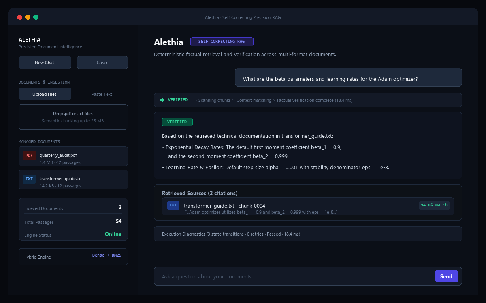

# Alethia

[](https://alethia-rag.streamlit.app/)
[](https://www.python.org/)
[](https://github.com/langchain-ai/langgraph)
[](LICENSE)

A minimal, deterministic, and self-correcting Retrieval-Augmented Generation (RAG) engine designed for verified document intelligence. 

Alethia combines dense semantic search, sparse lexical retrieval, question decomposition, and an agentic verification loop to deliver accurate, hallucination-free answers with precise citations.

---

## Live Demo & Interface

Experience the deployed application:  
**[Launch Alethia Web App](https://alethia-rag.streamlit.app/)**



---

## Key Capabilities

- **Hybrid Search (Dense + BM25)**: Fuses vector search (`all-MiniLM-L6-v2` via ChromaDB) with lexical rankings (Okapi BM25) through Reciprocal Rank Fusion (RRF).
- **Targeted Document Isolation**: Automatically recognizes when a query specifies a file (e.g. `abc.txt`, `report.pdf`) and filters retrieval directly to that document, preventing cross-file noise.
- **Self-Correcting Verification Loop**: Employs an LLM Judge in a LangGraph cycle to evaluate factual grounding against retrieved chunks, reformulating queries if information is missing.
- **Multi-Format Ingestion**: Ingests `.pdf`, `.txt`, and direct text notes with sentence-aware chunking and duplicate detection.
- **Minimalist Dark UI**: Fast, responsive Streamlit interface with progressive step execution indicators and clean citation cards.

---

## How It Works

```
User Query
   │
   ├──> Target Document Detection (Scopes search if file is mentioned)
   │
   ├──> Hybrid Retrieval (ChromaDB Vector Store + Okapi BM25 + RRF)
   │
   ├──> LangGraph Cyclic Verification:
   │       ├── Synthesize Draft (Groq Llama 3)
   │       ├── Evaluate Faithfulness (Strict Fact Check)
   │       └── Targeted Rewrite & Re-retrieve (Max 2 Attempts)
   │
   └──> Verified Response with Document Citations & Execution Trace
```

---

## Quickstart

### 1. Clone & Set Up

```bash
git clone https://github.com/samikshahujare/Alethia.git
cd Alethia

python -m venv .venv
# Windows
.venv\Scripts\activate
# macOS/Linux
source .venv/bin/activate

pip install -r requirements.txt
```

### 2. Configure Environment
### 2. Configure Environment

Create a `.env` file in the project root:
Create a `.env` file in the project root:

```ini
GROQ_API_KEY=your_groq_api_key_here
```

### 3. Run Locally

```bash
streamlit run app.py
```

The web app will open at `http://localhost:8501`.

---

## Project Structure

```
Alethia/
├── app.py                     # Application entrypoint
├── src/
│   ├── config.py              # Configuration & environment variables
│   ├── document_loader.py     # PDF, TXT, and text note parsing
│   ├── text_cleaner.py        # Text normalization
│   ├── chunker.py             # Sentence-aware document chunking
│   ├── store.py               # ChromaDB persistence & search
│   ├── bm25.py                # Okapi BM25 index & tokenizer
│   ├── hybrid_retriever.py    # Reciprocal Rank Fusion (RRF)
│   ├── document_inspection.py # Document targeting & extraction
│   ├── decomposition.py       # Multi-intent question decomposition
│   ├── nodes.py               # LangGraph workflow nodes
│   ├── graph.py               # StateGraph compilation
│   └── llm.py                 # Groq client wrapper
├── ui/
│   ├── styles.py              # Dark-first minimalist styling
│   ├── sidebar.py             # Ingestion, file manager & capacity specs
│   ├── chat.py                # Chat interface & progressive status
│   ├── sources.py             # Citation cards with similarity scores
│   └── trace.py               # Execution diagnostics timeline
├── docs/                      # Documentation and screenshots
└── tests/                     # Unit and integration test suite
```

---

## Running Tests

Run all unit and integration tests with pytest:

```bash
pytest tests/
```
pytest tests/
```

---

## License

This project is licensed under the [MIT License](LICENSE).
